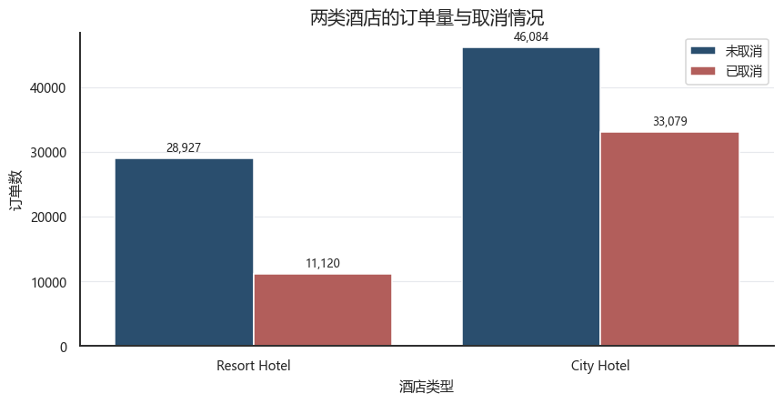
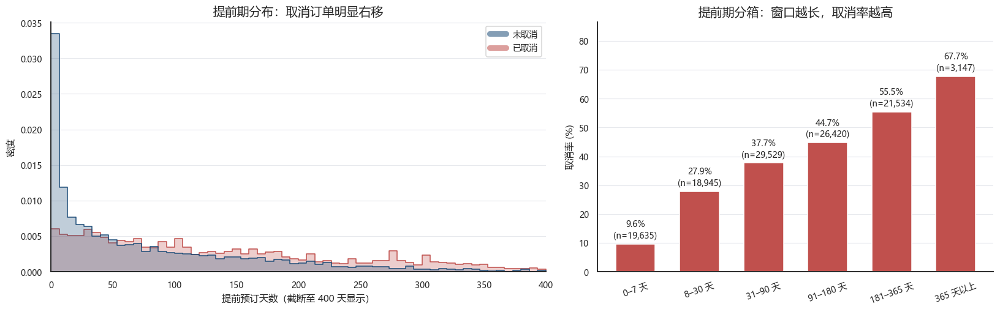
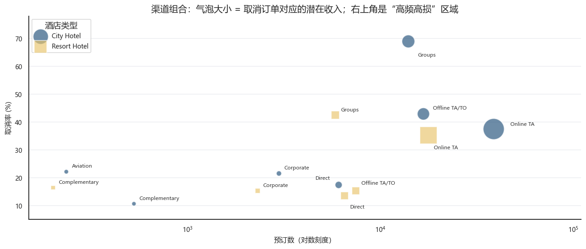
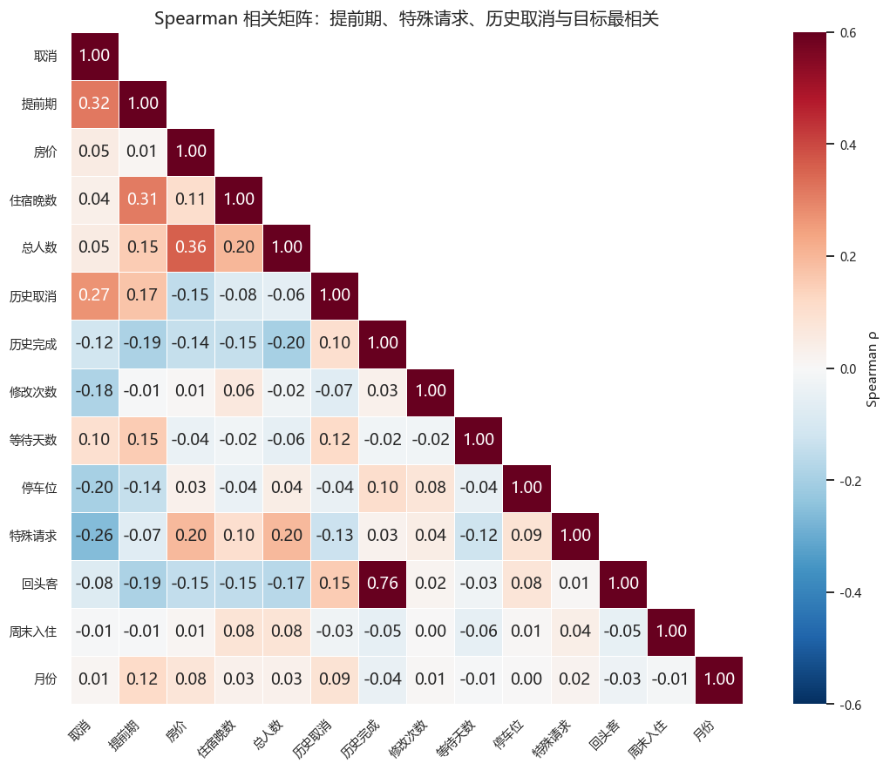

# 酒店预订取消行为分析｜Python EDA

基于 **Hotel Booking Demand** 数据集，分析酒店预订取消在酒店类型、入住时间、提前期、价格、渠道、客源地和客户行为上的差异，进一步结合**订单量、取消率和取消订单名义房费**，识别需要优先关注的订单群体与渠道。

- **数据规模：** 原始 119,390 条预订、32 个字段；清洗后 119,210 条，新增 18 个分析字段
- **工具：** Python、Pandas、NumPy、Matplotlib、Seaborn、Jupyter Notebook
- **分析方法：** 数据质量检查、特征构建、分组统计、占比与趋势分析、交叉比较、Spearman 相关分析
- **完整分析：** [查看 Jupyter Notebook](notebooks/hotel_booking_cancellation_eda.ipynb)（包含全部分析代码、图表和分组结果）

## 一、业务问题与分析思路

酒店需要根据预订情况安排房间库存和人员。不同订单的取消概率和涉及的房费规模并不相同。本项目围绕三个问题展开：

1. **取消主要集中在哪里？** 比较不同酒店、月份、渠道、客群和客源国的订单结构与取消情况。
2. **哪些预订特征与取消率有关？** 分析提前期、ADR、住宿时长、押金、特殊请求及历史行为等特征。
3. **运营上先关注哪些订单？** 不只看取消率，还综合订单量与取消订单名义房费确定重点对象。

分析流程：**数据检查与清洗 → 指标构建 → 多维 EDA → 渠道与客群重点诊断 → 运营建议**。

## 二、数据处理与指标构建

- **数据质量检查：** 检查缺失值、数据类型、重复与业务异常；识别零客人订单、零晚住宿、负 ADR 及价格极值。
- **清洗处理：** 剔除 180 条零客人订单；处理 `children`、`country`、`agent`、`company` 的缺失值；将负 ADR 调整为 0；保留零晚住宿记录用于分析。
- **衍生字段：** 构造入住日期、季节、总人数、总住宿晚数、提前期分组、价格与住宿分组、订单名义房费及历史取消比例等字段。
- **主要指标：** 预订量、取消率、订单量占比、ADR、订单名义房费、取消订单名义房费及其占比。

## 三、完整分析内容

| 分析模块 | 完成的分析与图表 | 主要观察 |
|---|---|---|
| **1. 酒店类型与客户画像** | 比较城市/度假酒店的订单量、取消率、提前期、住宿晚数、ADR；使用 **100% 堆叠图**比较客户类型和市场来源构成 | 城市酒店订单更多，取消率 **41.8%**；度假酒店 **27.8%**，两类酒店的客户与渠道结构也不同 |
| **2. 时间变化与季节性** | 酒店 × 季节取消率热力图；月度订单量与取消率；取消/未取消订单名义房费趋势；年份 × 月份热力图；两类酒店月度中位 ADR | 夏季总体取消率 **38.8%**、冬季 **33.1%**；度假酒店季节差异更明显 |
| **3. 预订提前期** | 提前期分布、取消与未取消订单对比、提前期分段取消率 | 提前 **180 天以上**取消率 **57.0%**，**7 天内**为 **9.6%**；取消订单的提前期中位数为 **113 天** |
| **4. 房价与住宿特征** | 住宿时长和入住人数分组取消率；两类酒店 ADR 分布与价格分组取消率 | ADR 与取消率不是简单的单调关系；城市酒店在各房价分组的取消率整体较高 |
| **5. 渠道、客群与押金** | 市场细分、分销渠道、客户类型和押金类型的取消率对比；结合 **订单量 × 取消率 × 取消订单名义房费**进行渠道比较 | **Online TA** 贡献约 **61.1%** 的取消订单名义房费；市场细分 **Groups** 的取消率为 **61.1%** |
| **6. 客源国** | 主要客源国订单量占比、取消率及取消订单名义房费比较 | **PRT** 占订单量约 **40.7%**，取消率 **56.7%**，是值得重点细分的客源市场 |
| **7. 客户预订行为** | 特殊请求次数、预订修改次数、历史取消次数、等待名单时长与取消率的关系 | 无特殊请求订单取消率 **47.8%**；至少有一项特殊请求的订单约 **21.8%** |
| **8. 变量相关性** | 对取消状态、提前期、ADR、住宿晚数及历史行为等数值变量绘制 **Spearman 相关矩阵** | 作为多维分组分析的补充，识别值得继续观察的变量关系 |

> 以上列出的是项目的**完整分析范围**。下方只挑选 4 张代表性图片展示；其余可视化及详细统计结果均在 Notebook 中。

## 四、主要发现与业务解释

### 1. 酒店结构和入住季节存在明显差异

城市酒店取消率达到 **41.8%**，高于度假酒店的 **27.8%**。两类酒店在客户类型、渠道来源及季节波动上也存在差别，因此适合分别监测取消情况，而不是只看整体平均值。

时间分析进一步比较了各月订单量、取消率与中位 ADR，并展示取消和未取消订单对应的名义房费规模。

### 2. 长提前期订单需要提前管理

预订提前 **180 天以上**的订单取消率为 **57.0%**，提前 **7 天内**仅 **9.6%**。两组差距较大；同时，取消订单的提前期中位数为 **113 天**，未取消订单为 **45 天**。这支持按提前期分组设置入住前确认节点。

### 3. 渠道优先级不能只按取消率排序

**Online TA** 的取消率为 **36.8%**，但由于订单规模大，约占取消订单名义房费总额的 **61.1%**，应成为重点监控渠道。相比之下，**Groups** 市场细分的取消率高达 **61.1%**，更适合单独开展团队订单管理。

渠道分析还比较了 **Direct、Corporate、Offline TA/TO** 等市场细分，以及不同分销渠道、客户类型和押金类型的表现。尤其需要区分 `market_segment=Groups` 与 `customer_type=Group`，两者不是同一个字段。

### 4. 行为特征能帮助进一步细分订单

无特殊请求订单的取消率为 **47.8%**，有至少一项特殊请求约 **21.8%**。Notebook 还分别比较了预订修改次数、历史取消记录和等待名单时长的分组差异，可为后续订单分层监控提供候选指标。

### 5. 结合金额规模评估重点对象

全部取消订单对应约 **1,673 万**名义房费，占样本全部订单名义房费的约 **39.2%**。这一指标与取消率、订单量一起用于比较渠道和客群的影响规模。

## 五、代表性可视化

**酒店类型：订单规模与取消情况**



**预订提前期：订单分布与分段取消率**



**渠道诊断：订单量、取消率与取消订单名义房费**



**数值变量：Spearman 相关矩阵**



**更多图表：** [查看 Notebook 中的全部分析](notebooks/hotel_booking_cancellation_eda.ipynb)，包括酒店客户与渠道构成、季节和月度热力图、ADR 趋势、住宿/房价分组、市场细分/押金对比、客源国及客户行为分析。

## 六、运营建议

| 优先对象 | 建议动作 | 可持续观察的指标 |
|---|---|---|
| Online TA、长提前期订单 | 设定入住前确认节点，提供改期选项 | 确认回复率、最终取消率 |
| 城市酒店旺季订单 | 监控临近入住取消，动态调整库存预案 | 临近取消率、房间空置情况 |
| Groups 团队订单 | 设置单独的订单确认与跟进流程 | 团队订单取消率、取消时点 |
| 重点客源国与渠道组合 | 按酒店和渠道建立分组监控 | 订单量、取消率、取消订单名义房费 |
| 存在历史取消记录的订单 | 纳入进一步订单分层与核查 | 分层取消率、复核覆盖率 |

## 七、项目结构与运行

```text
hotel-booking-cancellation-eda/
├── README.md
├── requirements.txt
├── notebooks/
│   └── hotel_booking_cancellation_eda.ipynb
├── assets/
│   ├── 01_hotel_cancellation.png
│   ├── 02_lead_time.png
│   ├── 03_channel_risk.png
│   └── 04_spearman.png
└── data/
    └── hotel_bookings.csv
```


## 八、数据来源与口径

**数据来源：** [Hotel Booking Demand（Kaggle）](https://www.kaggle.com/datasets/jessemostipak/hotel-booking-demand)；António, N., de Almeida, A., & Nunes, L. (2019), *Hotel booking demand datasets*, *Data in Brief*, 22, 41–49. [DOI](https://doi.org/10.1016/j.dib.2018.11.126)。

**指标说明：** 取消率 = 取消订单数 / 订单总数；订单名义房费 = ADR × 住宿晚数。取消订单名义房费用于衡量涉及的订单金额规模。数据涵盖 2015 年 7 月至 2017 年 8 月的两家酒店；分析为描述性 EDA未进行进一步预测及建模。

